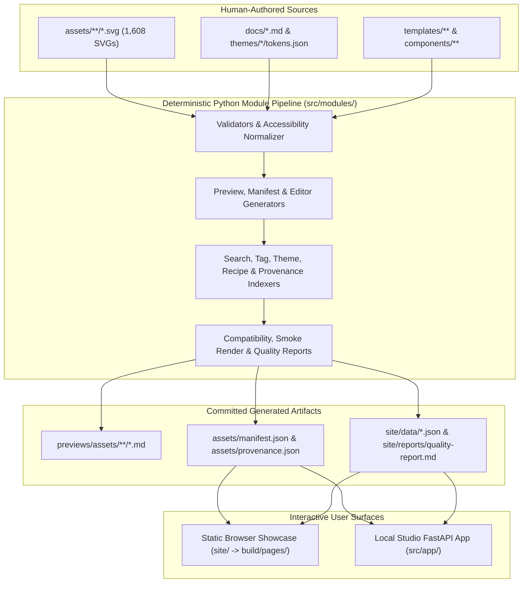
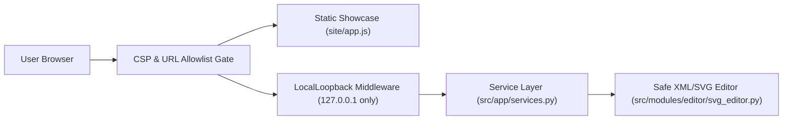

# Architecture & System Design

`readme-ux-kit` is a deterministic, local-first GitHub README design system, SVG asset catalog, static browser showcase, and local FastAPI studio.

## 1. High-Level System Architecture



## 2. Interactive Surface Request & Security Flow



## 3. Directory & Module Boundaries

| Layer | Path | Responsibility |
| --- | --- | --- |
| Curated SVG Library | [`assets/`](assets/README.md) | 1,608 self-contained, accessible SVG assets across 19 categories. |
| Generated Markdown Previews | [`previews/assets/`](previews/assets/README.md) | Category summaries and full per-group preview galleries. |
| Static Browser Showcase | [`site/`](site/index.html) | Zero-dependency static web app for searching, filtering, and editing SVGs in-browser. |
| Local Studio Server | [`src/app/`](src/app/api.py) | Loopback-only FastAPI app wrapping `src/modules` for local editing and GIF export. |
| Core Python Tooling | [`src/modules/`](docs/MODULES.md) | Deterministic generators, analyzers, indexers, schemas, and quality validators. |
| Themes, Recipes & Templates | [`themes/`](themes/README.md), [`templates/`](templates/README.md) | 19 color/token themes, composition recipes, and starter README layouts. |

## 4. Quality & Release Verification Gate

Run the complete deterministic verification suite with a single command:

```bash
npm run quality:gate
```
